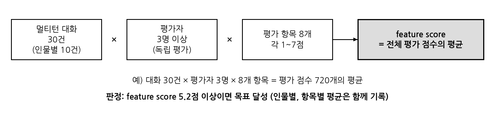

## 한 줄 요약

과제에는 공인 기관이 확인할 두 가지 시험 기준이 있습니다. **응답시간은 인물마다 평균 0.5초 이내**, **대화 품질은 사람 평가 5.2점 이상(7점 만점)**입니다. 처음 잰 응답시간 0.320초는 측정 도구의 함정 때문에 좋게 나온 값이었습니다. 함정을 고치고 기준을 "답 전체를 받을 때까지"로 바로잡자 7.8B 모델이 **0.495, 0.496, 0.486초**로 겨우 기준 안에 들었고, 사람 평가는 **6.10점**이었습니다. 시험용 원래 질문으로 다시 재면 7.8B는 0.502초로 기준을 넘었습니다. 그래서 시험에는 **학습 중 양자화(QAT)로 만든 2.4B 모델 + greedy 디코딩**을 쓰기로 정했습니다(0.261초). greedy는 속도를 올리지 않았고, 대신 같은 질문에 늘 같은 답을 내 측정을 재현할 수 있게 해 주었습니다. 모든 수치는 **공인 평가 전 자체 측정**입니다.

## 왜 필요했나

- 과제 성능지표 가운데 두 가지를 공인 평가로 확인받아야 합니다. 그 전에 시험 방법을 문서로 정하고, 같은 방법으로 직접 재 봐야 했습니다.
- 속도와 품질은 서로 당깁니다. 답을 짧게 하면 빨라지지만, 답이 너무 짧으면 안 된다는 요구가 있었습니다. 그래서 **답 길이를 줄이지 않고** 속도를 맞추는 방법을 찾아야 했습니다.

## 두 시험의 기준

표 읽는 법: 왼쪽 열이 같은 줄의 두 시험을 비교하는 기준입니다.

| 구분 | T-001 대화 반응 속도 | T-002 대화 맥락적 개인화 반응 (답변) 정확도 |
|---|---|---|
| 재는 것 | 질문을 보내기 직전부터 **답 전체를 받을 때까지** 걸린 시간 | 10턴 멀티턴 대화의 품질 |
| 규모 | 인물마다 길이가 다른 질문 10개 × 3회 = 30회, 세 인물 90회 | 인물마다 대화 10건(대화마다 10턴), 모두 30건 |
| 조건 | 모델 적재와 예열 질문 3개는 빼고 잼, 질문마다 새 대화, 반복마다 엔진 캐시를 비움 | 평가자 3명 이상이 서로 보지 않고 매김, **사람 점수만** 씀 |
| 기준 | 인물별 평균이 모두 **0.5초 이하** | 전체 평균(feature score) **5.2점 이상**(1~7점) |

T-002의 8개 항목입니다.

| 항목 | 이름 | 보는 것 |
|---|---|---|
| CB | 인물 일관성, 행동 | 인물의 성격과 가치관에 맞게 반응하는가 |
| CU | 인물 일관성, 발화 | 인물 고유의 말투와 어휘를 지키는가 |
| VK | 상황적 진위 | 생애, 작품, 주변 인물에 관한 지식이 맞는가 |
| RK | 사실적 진위 | 일반 사실이 맞는가, 잘못된 전제를 바로잡는가 |
| HK | 문맥적 진위 | 대화 맥락에서 근거 없는 정보를 지어내지 않는가 |
| Transfer | 역할 | 대화 내내 맡은 인물의 역할을 지키는가 |
| Relevance | 주제 관련성 | 질문과 사용자가 밝힌 정보에 맞게 답하는가 |
| Stability | 응답 안정성 | 10턴 내내 인물과 앞 대화 맥락을 유지하는가 |

## 용어 풀이

| 용어 | 뜻 | 이 글에서의 실제 값 |
|---|---|---|
| 응답시간 | 질문을 보낸 순간부터 답을 받을 때까지 걸린 시간 | 이 글은 답 **전체**를 받을 때까지로 잽니다 |
| 7.8B, 2.4B | 모델의 매개변수 수(78억 개, 24억 개). 클수록 대체로 똑똑하지만 느립니다 | 기반 모델 EXAONE 3.5 7.8B, 2.4B |
| vLLM | 언어 모델 답을 빠르게 만들어 주는 추론 엔진 | 세 인물 모델 모두 vLLM으로 돌림 |
| 접두 캐시(prefix cache) | 앞에서 처리한 입력과 앞부분이 같으면 그 계산 결과를 저장해 두었다가 다시 쓰는 기능 | 같은 질문을 3번 반복하면 2, 3회차가 빨라짐 |
| 예열(워밍업) | 측정 전에 엔진을 미리 한 번 돌려 처음 한 번만 느린 부분을 빼는 것 | 예열 질문 3개는 측정에서 뺌 |
| 문장 임베딩 | 문장을 숫자 벡터로 바꿔 비슷한 문장을 찾게 하는 것. 인물 프로필에서 질문과 관련된 문단을 찾을 때 씀 | bge-m3 모델 |
| 양자화, INT4 | 모델 가중치를 작은 정수로 줄여 메모리와 계산을 아끼는 것. INT4는 4비트 정수 | 7.8B 모델 15.64GB → 5.39GB |
| 학습 후 양자화(PTQ) | 학습을 마친 뒤 한 번에 4비트로 줄이는 방식 | 이 프로젝트는 쓰지 않음 |
| 학습 중 양자화(QAT) | 학습하는 동안 매번 4비트로 줄였을 때의 오차를 미리 겪게 해서, 4비트로 줄인 뒤에도 성능이 덜 떨어지게 하는 방식 | torchao INT4, 그룹 크기 128 |
| KL 정규화 | 학습한 모델의 다음 토큰 확률이 학습 전 모델과 너무 멀어지지 않도록 벌점을 주는 것 | λ(가중치) 0.1 |
| greedy 디코딩 | 답을 만들 때 매번 확률이 가장 높은 토큰만 고르는 방식. 같은 질문에는 늘 같은 답이 나옴 | top-k 1, temperature 0 |
| 공인 평가 전 자체 측정 | 공인 기관이 아니라 우리가 같은 절차로 직접 잰 값 | 이 글의 모든 수치 |

## 무엇을 했나

1. **처음 측정(10-16).** 세 인물 평균 0.320초가 나왔습니다. 기준보다 한참 빨랐습니다.
2. **측정 도구 점검(10-19).** 검토하던 중 "1회차만 튄다"는 지적이 나왔습니다. 확인해 보니 같은 질문을 3번 반복할 때 2, 3회차가 **1회차의 입력 처리 결과를 접두 캐시에서 다시 써서** 빨라진 값이 섞여 있었습니다. 실제 사용자는 같은 질문을 연달아 세 번 하지 않으므로, 반복마다 캐시를 비우고 측정에 넣지 않는 질문으로 엔진을 다시 예열하도록 도구를 고쳤습니다.
3. **느린 곳 나누기(10-19).** 시험 문서의 GPU 기준이 "RTX 4090급 이상"이라 RTX 4090에서도 캐시를 비우는 방식으로 재 보니 평균 0.743초로 기준을 넘었습니다. 시간을 나눠 보니 답을 쓰기 전 CPU 처리 0.12~0.23초(검색용 문장 임베딩을 CPU에서 계산), 질문마다 새 입력 380~560토큰을 처리하는 데 0.30~0.39초가 들었습니다. 답 길이만 줄이는 재학습(평균 60자 답)은 답이 너무 짧아져 보류했습니다.
4. **기준을 "답 전체 수신"으로 바로잡음(10-19).** 과제 계획서의 평가 방법은 "질의에 대해 답변 텍스트를 얻는 과정"의 소요 시간이고, "첫 답변"이라는 말이 없었습니다. 그래서 첫 문장이 나올 때까지가 아니라 답 전체를 받을 때까지로 기준을 바꾸고 측정 도구의 기본값도 바꿨습니다.
5. **답 길이를 건드리지 않고 줄이기.** 문장 임베딩 계산을 GPU로 옮겼습니다. 대화 모델은 학습 단계부터 학습 중 양자화(QAT)로 INT4에 맞춰 학습했습니다(아래 절).
6. **7.8B 모델 측정(10-19).** 고친 도구와 새 기준으로 세 인물의 7.8B 모델을 다시 쟀습니다. 0.495, 0.496, 0.486초로 기준 안이지만 여유가 1% 남짓이었습니다.
7. **2.4B 시험용 모델 측정(10-21).** 같은 방식으로 학습한 2.4B 모델을 RTX 4090에서 재고, 그 대화로 사람 평가도 다시 받았습니다.
8. **시험 원래 질문으로 다시 재고 설정 확정(11-06).** 시험 문서의 원래 질문으로 다시 재니 7.8B는 기본 설정 0.502초, greedy 0.499초로 화가 두 인물이 기준을 넘었습니다. 2.4B + greedy는 0.261초였습니다. 그래서 공인 평가에는 **2.4B 시험용 모델 + greedy**를 쓰기로 정했습니다.
9. **greedy가 품질을 떨어뜨리는지 확인(11-06).** 같은 대화 30건을 기본 설정과 greedy로 각각 만들고, 어느 쪽 답인지 가린 채 LLM 자동 평가로 T-002 8개 항목을 매겨 비교했습니다.

## 학습 중 양자화와 KL 정규화

표 읽는 법: 두 양자화 방식이 언제 4비트로 줄이는지, 그 차이가 무엇인지 비교합니다.

| 구분 | 학습 후 양자화(PTQ) | 학습 중 양자화(QAT, 적용) |
|---|---|---|
| 4비트로 줄이는 때 | 학습이 끝난 뒤 한 번 | 학습 내내 계산할 때마다 |
| 4비트 오차를 처음 겪는 때 | 실제로 쓸 때 | 학습 중에 겪으며 맞춰 감 |
| 추가 학습 | 없음 | 있음 |

표 읽는 법: 16비트(bf16) 모델을 INT4로 줄였을 때의 파일 크기입니다. 답을 만들 때 토큰마다 가중치를 메모리에서 읽으므로, 읽을 양이 줄면 그만큼 빨라집니다.

| 모델 | bf16 | INT4 | 비율 |
|---|---|---|---|
| EXAONE 3.5 7.8B | 15.64GB | 5.39GB | 34% |
| EXAONE 3.5 2.4B | 약 4.82GB | 1.83GB | 38% |

- 학습 설정: 전체 파인튜닝 10에폭(에폭은 학습 자료 전체를 한 바퀴 도는 단위), 학습률 2e-5, 유효 배치 8, 최대 길이 8,192토큰, torchao INT4 가중치 전용 양자화(그룹 크기 128).
- 손실 = 정답 토큰 교차 엔트로피 + 0.1 × KL(학습 전 모델 ‖ 학습 중 모델). 기준이 되는 학습 전 EXAONE 3.5는 고정해 두고, 답 토큰에서만 계산합니다. 학습 자료에 없는 질문에서 원래 모델의 능력을 덜 잃게 하려는 장치입니다.

## 실제 예시

측정 함정이 숫자를 얼마나 바꿨는지, 10-16 같은 측정 기록을 기준별로 다시 계산한 값입니다(세 인물 평균, 초).

| 계산 기준 | 값 |
|---|---|
| 첫 답변 글까지 + 2, 3회차 캐시 재사용 포함(처음 보고한 값) | 0.320 |
| 답 전체까지 + 캐시 재사용 포함 | 0.463 |
| 새 질문 조건(1회차만), 첫 답변 글까지 | 0.459 |
| 새 질문 조건(1회차만), 답 전체까지 | 0.596 |

평균을 내는 방법을 실제 값으로 따라가 보겠습니다.

1. T-001 조수미: 질문 10개 × 3회 = 30번 잰 시간의 평균이 0.495365초 → 0.495초.
2. T-002: 대화 30건 × 평가자 3명 × 8항목 = 720칸의 사람 점수를 모읍니다. 대화마다 평가자 평균을 내고, 항목별로 평균을 낸 뒤, 8개 항목을 평균합니다. 조수미 6.0375, 김홍도 6.0458, 정선 6.225 → 전체 6.1028 → **6.10점**.

## 결과

표 읽는 법: 인물별 평균 응답시간(초)과 사람 평가 점수입니다. 응답시간은 답 전체를 받을 때까지, 사람 평가는 평가자 3명이 8개 항목을 1~7점으로 매긴 평균입니다. 모두 공인 평가 전 자체 측정입니다.

| 측정 대상 | 조수미 | 김홍도 | 정선 | 전체 | 판정 |
|---|---|---|---|---|---|
| 7.8B 모델 응답시간(10-19) | 0.495 | 0.496 | 0.486 | 0.492 | 기준 이내 |
| 7.8B 모델 사람 평가(10-16 대화) | 6.04 | 6.05 | 6.22 | 6.10 | 기준 이상 |
| 2.4B 시험용 모델 응답시간(10-21, RTX 4090) | 0.405 | 0.369 | 0.374 | 0.383 | 기준 이내 |
| 2.4B 시험용 모델 사람 평가(10-21 대화) | 6.46 | 6.58 | 6.48 | 6.51 | 기준 이상 |

표 읽는 법: 시험 문서의 원래 질문 30개로 같은 GPU에서 다시 잰 응답시간(초)입니다. 굵은 줄이 공인 평가에 쓰기로 정한 설정입니다.

| 모델, 디코딩 | 조수미 | 김홍도 | 정선 | 전체 | 판정 |
|---|---|---|---|---|---|
| 7.8B INT4, 기본 | 0.470 | 0.530 | 0.507 | 0.502 | 미달 |
| 7.8B INT4, greedy | 0.436 | 0.557 | 0.504 | 0.499 | 미달(김홍도, 정선) |
| **2.4B INT4, greedy** | **0.246** | **0.291** | **0.246** | **0.261** | **기준 이내** |

<figure class="xp">
11-06 같은 질문 30개로 잰 평균 응답시간(초, 짧을수록 좋음)

7.8B 기본<i class="xp-fill bad" style="width:83.7%"></i><i class="xp-line" style="left:83.3%"></i>0.5027.8B greedy<i class="xp-fill bad" style="width:83.2%"></i><i class="xp-line" style="left:83.3%"></i>0.4992.4B greedy<i class="xp-fill" style="width:43.5%"></i><i class="xp-line" style="left:83.3%"></i>0.261

세로선이 기준 0.5초입니다. 7.8B는 전체 평균이 기준 근처이고, 화가 두 인물은 인물별 평균이 0.5초를 넘었습니다. 회색 막대가 기준을 채우지 못한 설정입니다.
</figure>

표 읽는 법: 2.4B 시험용 모델로 같은 대화 30건(300턴)을 기본 설정과 greedy로 각각 만든 결과입니다. 응답시간은 규칙 측정, 품질은 LLM 자동 평가(어느 설정의 답인지 가린 블라인드 평가, T-002 8항목, 사람 점수 아님)입니다.

| 지표 | 조수미 | 김홍도 | 정선 | 전체 |
|---|---|---|---|---|
| 응답시간, 기본(초) | 0.550 | 0.420 | 0.399 | 0.456 |
| 응답시간, greedy(초) | 0.565 | 0.446 | 0.399 | 0.470 |
| 자동 평가 품질, 기본 | 4.59 | 5.65 | 4.80 | 5.01 |
| 자동 평가 품질, greedy | 4.85 | 5.25 | 5.17 | 5.09 |

- 응답시간: 같은 턴끼리 짝지은 차이 평균 +0.013초(부트스트랩 95% 구간 −0.001 ~ +0.031). greedy가 더 빠르지 않습니다.
- 품질: 대화별 차이 평균 +0.08점(95% 구간 −0.15 ~ +0.30). 떨어졌다고 볼 근거가 없습니다. 다만 인물별로는 김홍도가 0.40 낮아졌습니다(앞 답의 구절을 반복하는 답이 늘어 역할 유지 점수가 내려감).
- 재현성: greedy로 두 번 돌린 답 300개가 **300/300 글자까지 같았습니다.**

## 그래서 무슨 뜻인가

- **측정 도구가 결과를 크게 바꿉니다.** 같은 기록을 어떻게 세느냐에 따라 0.320초에서 0.596초까지 달라졌습니다. 공인 평가에서 재현될 숫자를 얻으려면 캐시, 예열, "어디까지를 응답으로 볼지"를 먼저 정해야 합니다.
- **0.5초 기준은 2.4B INT4 모델에서 왔습니다.** greedy는 7.8B를 빠르게 만들지 못했습니다(0.502 → 0.499). greedy가 준 것은 답이 늘 같아 측정이 재현된다는 점입니다.
- **크기별 역할을 나눴습니다.** 7.8B는 대화 품질이 더 좋아 서비스용으로, 2.4B는 시험 절차서용으로 씁니다. 2.4B를 서비스용 패키지로 만들지는 않습니다.

## 한계와 남은 일

- 모든 수치는 공인 평가 전 자체 측정입니다. 시험은 서버 안에서 재고 화면 표시 지연은 넣지 않지만, 공인 평가 때의 장비와 부하에 따라 값이 달라질 수 있습니다.
- 7.8B 조수미 모델은 다른 날 같은 방법으로 재면 0.502~0.512초로 기준을 넘기도 했습니다. 7.8B는 0.5초 경계에 있습니다.
- 사람 평가는 10-16, 10-21 대화로 받은 것입니다. 그 뒤 새로 학습한 모델은 아직 사람 평가를 받지 않았습니다.
- LLM 자동 평가는 사람보다 1점 넘게 낮게 매겼습니다(사람 6.10, 6.51을 받은 대화가 자동 평가로는 5.29, 4.99). 자동 평가 점수와 사람 점수를 같은 눈금으로 읽으면 안 됩니다.
- greedy는 답이 고정되므로, 공인 평가 전에 30건의 답을 미리 읽어 약한 턴을 알아 두어야 합니다.
- KL 정규화를 끈 학습과 직접 비교한 실험은 없습니다. 효과는 아직 확인하지 않았습니다.

## 관련 기록

- [페르소나 LLM 연구 개요](../research/persona-llm.html)
- [작은 모델과 큰 모델: 모든 에폭을 가리고 평가하다](2026-10-21-persona-model-size.html)
- [LLM 자동 평가를 믿을 수 있게](2026-11-02-persona-judge-reliability.html)
- [기억을 묻는 질문과 프로필 주석 문제](2026-11-06-persona-memory-data.html)
- [페르소나 LLM 진행 상황](2026-11-10-persona-status.html)
