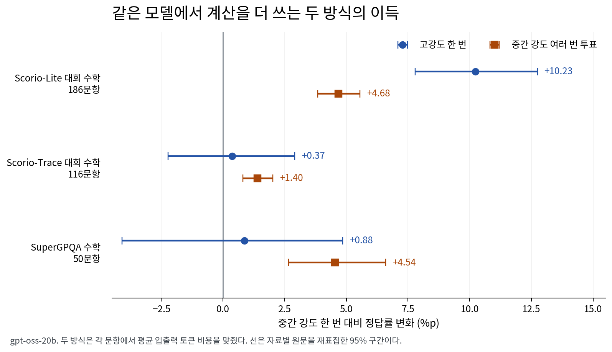

**같은 토큰으로 고강도 응답 한 번이 유리한 수학 문제와 중간 강도의 여러 답을 투표하는 편이 유리한 문제가 모두 있었습니다.** gpt-oss-20b의 같은 186문항에서 정답과 과거 40개 응답을 보고 두 행동 중 하나를 고르자, 따로 보관한 40개에서 정확도가 75.13%였습니다. 늘 고강도로 한 번 풀었을 때보다 **+2.10%p [0.97, 3.42]** 높았습니다. 같은 문제의 정답과 이력을 알고 내린 선택입니다. 실제로 새 대회의 문제만 읽고 고강도 한 번 또는 중간 강도 세 번을 고른 규칙은 고강도 고정보다 **−2.04%p [−3.38, −0.89]** 낮았고 토큰도 줄이지 못했습니다. 별도 수학 선택형 50문항에서는 고정 중간 투표가 더 잘 맞혔지만, 두 행동을 고르는 추가 이득은 **+0.52%p [−1.48, +2.70]**로 재현 기준에 미달했습니다.

## 같은 문제에서 추론 강도를 높이거나 여러 번 풀면 각각 얼마나 더 맞혔나

**고강도 한 번의 이득은 대회 수학 두 자료에서도 크게 달랐습니다.** Scorio-Lite에서는 중간 강도로 한 번 풀 때보다 10.23%p 높았고, Scorio-Trace에서는 0.37%p 높았습니다. 중간 강도 답을 여러 번 얻어 투표했을 때의 이득은 각각 4.68%p와 1.40%p였습니다. 별도 SuperGPQA 수학에서는 고강도 한 번이 0.88%p, 중간 강도 투표가 4.54%p 높았습니다.

점은 동일 원문을 중간 강도로 한 번 푼 정답률을 기준으로 한 변화량이고, 가로선은 자료별로 문항을 복원추출한 95% 구간입니다. 각 문항에서 고강도 한 번과 중간 강도 투표의 평균 입력·출력 토큰 비용을 맞췄습니다. Scorio-Trace는 전체 120문항 중 이 비교가 가능했던 116문항입니다. 시험 구성, 채점 방식, 생성 토큰 상한이 자료마다 달라 세 평균의 차이를 선택지 유무 하나로 설명할 수 없습니다. [Scorio-Trace 네 대회의 문항별 결과와 채점 검산](2026-11-20-x-trace-effort-transfer.html)

## 실제 어느 문제에서 선택이 바뀌었나

- **고강도 한 번이 유리했던 약수 문제.** HMMT 2025년 11월 자료 ID 6은 양의 약수 중 99%를 넘는 수가 원래 정수의 1%보다 작을 때, 그 조건을 만족하는 2,000의 배수가 가질 수 있는 최소 약수 개수를 묻습니다. 공식 답은 1,305입니다. 고강도로 한 번 풀면 두 40회 반분에서 **77.5%, 72.5%**였습니다. 같은 예산으로 중간 강도를 3.68회, 3.78회 투표하면 **13.5%, 4.7%**였습니다.
- **중간 강도 투표가 유리했던 삼각형 문제.** HMMT 2026년 2월 자료 ID 26은 이등변삼각형 ABC 안에서 BP=PQ=QC이고 꼭짓점 A의 각이 20°, 46°, 26°로 나뉠 때 ∠APC를 묻습니다. 공식 답은 74°입니다. 고강도 한 번은 **32.5%, 27.5%**였지만 같은 토큰으로 중간 강도를 4.51회, 5.14회 투표하면 **97.0%, 98.9%**였습니다.

두 예는 양방향에서 일관되게 차이가 컸던 문항으로 골랐습니다. 3.68회처럼 표시한 횟수는 세 번과 네 번 중 하나를 확률적으로 골라 기대 토큰을 맞춘 값입니다. [원 연구팀의 수학 입력·생성 자료](https://huggingface.co/datasets/harimo/scorio-lite/tree/8a00506b9f016b7136b366f105f137d5947d5093)

## 과거 성적을 알 때의 등비용 비교

모든 문항에서 높은 강도와 중간 강도의 시드 80개를 같은 기준으로 40개씩 두 반분으로 나눴습니다. 한쪽에서 고강도 한 번의 정답률과 같은 기대 토큰의 중간 투표 정답률을 원문별로 비교해 예산을 배분할 행동을 정했습니다. 맞힌 비율은 반대쪽에서 평가하고 두 방향을 평균냈습니다. 입력과 출력을 합쳐 양쪽 평균 예산은 **문항당 37,468토큰**, 같은 예산에 들어가는 중간 강도 생성은 반분별 중앙값 3.07회였습니다.

| 수학 186문항 | 고강도 한 번 | 등비용 중간 강도 투표 | 과거 정답을 아는 선택 | 고강도 고정 대비 선택 이득 [95% 구간] |
|---|---:|---:|---:|---:|
| 공개된 원래 등급 | 73.03% | 67.49% | 75.13% | +2.10%p [+0.97, +3.42] |
| 길이 상한에 닿으면 모두 오답 | 72.09% | 67.49% | 74.54% | +2.45%p [+1.23, +3.87] |

두 반분에서 모두 5%p 이상 더 맞힌 문항은 고강도 한 번 쪽 52개, 중간 강도 투표 쪽 16개였습니다. 각 방향 최소 10개, 더 좋은 단일 정책 대비 +1%p 이상, 그 차이의 원문 단위 95% 구간 하한이 0 초과라는 사전 기준을 충족했습니다. 상한 도달을 모두 오답 처리하면 각각 49개와 19개였습니다. 공개 등급상 고강도에서 상한에 닿은 2,399개 중 140개는 정답이었습니다.

이전 저강도 투표와의 결과도 같은 문항으로 다시 비교했습니다. 세 행동 모두 기대 비용을 맞출 수 있던 158문항에서 평균 **31,280토큰**을 주면, 저강도 투표 49.92%, 중간 강도 투표 76.58%, 고강도 한 번 81.33%였습니다. 전체 186문항과 다른 분모이므로 158문항 안에서 수치를 비교해야 합니다. [저강도 투표 대조, 원자료 감사와 기초 정답률 통제](2026-11-20-u-effort-and-votes.html)

같은 186문항에서 짝수·홀수 시드와 처음·마지막 40시드로 나누는 두 방식, 답 추출과 미판독 처리 세 방식을 조합한 여섯 민감도 분석도 모두 사후 이력 선택의 같은 기준을 통과했습니다. 고정 고강도 대비 이득은 +1.97~+2.12%p였습니다. AIME, CMIMC, HMMT, SMT 네 대회 계열을 하나씩 제외해도 +1.55~+2.39%p였습니다. 이는 같은 자료의 분할·판독에 대한 견고성으로, 여섯 번의 독립 재현은 아닙니다.

긴 추론과 병렬 투표를 비교한 연구, 문제를 읽고 추가 계산의 이득을 예측한 연구, 병렬화에 따라 지연시간과 토큰 비용의 관계가 달라지는 연구가 있습니다. 원문별 기대 입력·출력 토큰을 맞춘 이번 평가는 동시 처리 지연과 실제 서비스 요금까지 같게 만든 실험은 아닙니다. [Snell 등의 MATH 순차·병렬 비교](https://arxiv.org/html/2408.03314v1) [Learning How Hard to Think](https://proceedings.iclr.cc/paper_files/paper/2025/hash/ff414825df833edb8b1839e3d5d495e9-Abstract-Conference.html) [Faster and Better LLMs via Latency-Aware Test-Time Scaling](https://aclanthology.org/2025.findings-emnlp.928/)

Hard2Verify의 그림 5와 5.1절은 이미 **같은 gpt-oss-20b**에서 고강도 1회와 저강도 N회 다수결을 수학 풀이의 오류 단계 검증에 직접 비교했습니다. 여기서는 원 문제의 끝답을 생성하는 행동을 비교하고, 같은 원문·체크포인트에서 비용과 행동별 성적 이력이 갖는 의미를 검사했습니다. [Hard2Verify 그림 5와 5.1절](https://arxiv.org/html/2510.13744v1#S5.SS1)

## 새 대회에서 문제만 보고 어느 행동을 고를 수 있었나

**어휘와 문제 길이만 쓰는 실제 선택 규칙은 고강도 한 번을 고정한 경우보다 2.04%p 낮았고 비용도 줄지 않았습니다.** AIME, CMIMC, HMMT, SMT 네 대회 계열을 하나씩 통째로 보류했습니다. 나머지 대회에서 문제 어휘와 길이를 사용한 선형 회귀에 규제를 걸어 두 행동의 차이를 학습한 뒤, 보류한 계열 전체에 적용했습니다. HMMT 두 시험은 함께 보류했습니다. 시험 때는 정답, 대회명, 문항 번호, 생성 응답이나 미래 비용을 볼 수 없습니다. 이번 실제 선택의 두 번째 행동은 모든 문항에서 **정확히 중간 강도 세 번**입니다.

| 새 대회에서 사용하는 규칙 | 기대 정확도 | 평균 입력 토큰 | 평균 출력 토큰 | 평균 전체 토큰 |
|---|---:|---:|---:|---:|
| 항상 고강도 한 번 | 73.03% | 204 | 37,264 | 37,468 |
| 항상 중간 강도 세 번 투표 | 67.89% | 613 | 37,024 | 37,638 |
| 문제 길이만 보고 선택 | 73.03% | 204 | 37,264 | 37,468 |
| 문제 어휘와 길이로 선택 | 70.99% | 260 | 37,257 | 37,517 |

길이만 쓰면 186문항 전부 고강도를 골랐습니다. 어휘까지 쓰면 157문항에 고강도, 29문항에 중간 강도 세 번을 골랐습니다. 행동을 바꾼 29문항에서 8개는 좋아졌고 18개는 나빠졌으며 3개는 같았습니다. 제일 좋은 고정 행동과의 정확도 차이는 **−2.04%p [−3.38, −0.89]**였습니다. 대회별 문항 수를 유지하고 원문 단위로 재표집한 구간입니다. 비교한 186문항과 원 출력은 앞 실험과 같고, 문제 어휘를 학습할 때는 평가 대회 전체를 배제했습니다. 같은 원문에서 이미 얻은 40개 응답과 정답을 보는 실험의 +2.10%p를 새 문제에서의 성능으로 주장할 수 없습니다. [문제 특성에 따른 앙상블 선택 선행 연구 EPIC](https://arxiv.org/abs/2511.00521)

## 중간 강도 투표가 유리할 때 어디에서 정답이 늘었나

한쪽 40회에서 중간 강도 투표가 고강도 한 번보다 5%p 이상 좋았던 문항을 고른 후, 반대쪽 40회에서 무엇이 달라졌는지 분해했습니다. 양방향을 합쳐 고유 **44문항, 문항·반분 쌍 60개**였습니다. 중간 투표와 고강도 단일의 차이 **+11.48%p [5.61, 17.55]** 중, 중간 단일을 중간 투표로 바꾼 부분이 **+9.23%p [6.82, 11.68]**였습니다. 단일 응답끼리 중간이 고강도보다 나은 정도는 +2.25%p [−2.92, +7.54]로 0을 포함했습니다.

반대로 고강도 한 번이 5%p 이상 유리했던 **72문항, 문항·반분 쌍 124개**에선 고강도 단일 응답이 중간 단일보다 +27.54%p 높았습니다. 중간 강도에서 투표를 추가하면서 +5.31%p 올랐지만, 고강도 단일과의 격차는 남았습니다. 이 분해는 앞서 관측한 두 행동의 차이가 어떤 점수에서 나왔는지 설명하며, 문항을 풀기 전에 선택할 수 있는 새로운 규칙은 제시하지 않습니다.

## 문항당 중간 강도 세 번으로 고정해도 선택할 가치가 있었나

**사후 이력을 아는 선택과 어휘 정책에 똑같은 두 행동을 주어도 둘의 차이는 남았습니다.** 같은 수학 186문항에서 고강도 한 번 또는 중간 강도 **정확히 세 번** 중 앞선 40회 정답으로 행동을 선택하면 정확도 75.12%, 비용은 36,978토큰이었습니다. 고강도 고정(73.03%, 37,468토큰) 대비 +2.09%p [1.12, 3.24]로 정확도가 올랐고 평균 비용은 1.31% 낮았습니다. 과거 이력 선택은 29.30%의 문항에 중간 강도 세 번을 배정했습니다. 같은 비율을 무작위로 배정하면 71.53%, 37,518토큰으로 결과가 달랐습니다. 고정 횟수로 얻은 +2.09%p는 비용에 맞춰 투표 수를 달리한 앞선 +2.10%p와 구분됩니다.

## 저강도 답을 먼저 사서 판단하면 비용을 회수할 수 있었나

**첫 저강도 응답을 실제 비용에 포함하면 선택 규칙은 고강도 한 번보다 문항당 1,900토큰 더 쓰고 정확도는 0.15%p 낮았습니다.** 다섯 대회 회차를 하나씩 보류하고 평가했습니다. 같은 gpt-oss-20b가 낸 저강도 답의 판독 가능 여부, 실제 출력 길이, 생성 시 기록된 평균 토큰 로그확률만 보고, 그 답을 제출하거나 새 고강도 한 번 또는 중간 강도 세 번 투표 중 하나를 고르게 했습니다. 전체 186문항에서 72.88%, 39,368토큰으로 고강도 고정 73.03%, 37,468토큰 대비 **−0.15%p [−0.39, +0.03]**, 토큰 **+5.07%**였습니다. 저강도 신호를 얻는 비용까지 청구한 정책은 승격 기준에 미달했습니다. HMMT의 2월·11월 회차를 함께 보류했던 앞선 어휘 실험과 여기서 사용한 다섯 회차 제외는 서로 다른 평가 단위입니다.

## 독립 선택형 수학 50문항에서는 고정 행동의 순서가 뒤바뀌었나

**같은 모델이 별도 수학 선택형 50문항을 풀자 가장 좋은 고정 행동이 중간 강도 투표로 바뀌었습니다. 두 행동을 문제마다 골라 추가 이득을 낸다는 기준은 재현되지 않았습니다.** Scorio 생성에서 공식 분야가 Mathematics인 모든 50문항만 선정했습니다. 원문·선택지·정답 문자를 공식 SuperGPQA 자료에서 대조한 뒤, 고강도·중간 강도 각 4,000회, 총 8,000개에서 같은 40/40 시드, 같은 기대 입력·출력 비용, 같은 통과 기준을 적용했습니다. 모든 50문항이 등비용 비교에 포함됐고 평균은 18,040토큰, 등비용 중간 강도 횟수의 중앙값은 3.04회였습니다. [Scorio 공식 생성](https://huggingface.co/datasets/harimo/scorio-lite/tree/8a00506b9f016b7136b366f105f137d5947d5093/meta-gpqa) [공식 SuperGPQA 문항과 선택지](https://huggingface.co/datasets/m-a-p/SuperGPQA/tree/4430d4458112c7d4497fdcf94d7cc223313d6acf)

| 독립 수학 50문항 | 고강도 한 번 | 등비용 중간 투표 | 과거 40회 정답으로 선택 | 더 좋은 고정 정책 대비 [95% 구간] | 양 반분에서 ≥5%p 우세한 수, 고강도/중간 |
|---|---:|---:|---:|---:|---:|
| 공식 정답 문자 채점 | 76.78% | 80.44% | 80.96% | +0.52%p [−1.48, +2.70] | 3 / 7 |
| 상한에 닿으면 오답 | 76.23% | 80.45% | 80.94% | +0.50%p [−1.50, +2.73] | 3 / 7 |

예를 들어 군과 체에 관한 명제 중 참인 수를 묻는 문제의 공식 답은 6개였습니다. 고강도는 두 반분에서 72.5%, 70.0%, 같은 비용의 중간 투표는 22.24%, 36.69%였습니다. 반대로 자릿수를 뒤집고 제곱하는 순서를 비교해 수열을 선택하는 문제에선 고강도가 2.5%, 5.0%, 중간 투표가 97.65%, 99.18%였습니다. 후자에서 고강도는 두 반분 중 40/40회와 38/40회가 상한에 도달했습니다. 두 예는 결과 확인 후 양방향의 차이가 두 반분에서 크게 유지된 문항을 골랐습니다.

원자료의 전역 ID, UUID, 선택 해시와 정규화한 문제를 두 강도 사이에 대조했습니다. 단계별 로컬 ID는 40/50문항에서 서로 달랐습니다. 공식 선택지 수는 7~10개였고 공식 정답 문자로 채점한 결과는 8,000회 전부 저장 등급과 일치했습니다. 이전 대회 186개와 새 50개 원문의 전체 9,300쌍에서 정규화한 완전일치는 0개였습니다. 비정상 표와 실제로 쓴 토큰을 포함했고, 다른 분야의 문제와 풀이 전문은 읽지 않았습니다.

이전 대회는 자유형 끝답이었고 이번 수학 원문은 선택지 안에서만 답을 고릅니다. 대회에서 상보적인 두 행동을 관측한 결과는 유지되지만, **양쪽 행동에 유리한 원문을 각각 10개 이상 확보하고 좋은 고정 행동보다 1%p 이상 더 맞힌다는 독립 검증 기준은 미달했습니다.**

## 두 자료 사이에서 고정 행동의 우세가 바뀐 이유

**중간 강도의 응답을 모아 투표하면서 얻은 평균 이득은 대회와 선택형 수학에서 각각 +4.68, +4.54%p였습니다. 크게 달라진 값은 고강도 단일 응답이 중간 강도 단일 응답보다 더 맞힌 정도로, +10.23%p에서 +0.88%p로 작아졌습니다.** 두 자료에서 고정 행동의 평균 우세가 반대로 나타난 뒤 세부 분해와 구간 계산 기준을 고정해 실행했습니다.

| 구성 요소 | 대회 수학 186문항 | 선택형 수학 50문항 | 두 번째 자료 − 첫 번째 자료, %p [95% 구간] |
|---|---:|---:|---:|
| 중간 단일 − 고강도 단일 | −10.23%p | −0.88%p | +9.35 [4.68, 14.59] |
| 등비용 중간 투표 − 중간 단일 | +4.68%p | +4.54%p | −0.14 [−2.28, +2.12] |
| 등비용 중간 투표 − 고강도 단일 | −5.55%p | +3.66%p | +9.21 [4.39, 14.75] |

자료를 바꿨을 때 단일 응답끼리의 격차 변화가 투표 추가 이득의 변화보다 **9.50%p [3.84, 15.39]** 컸습니다. 두 자료 안에서 원문을 각각 재표집한 구간입니다. 두 투표 이득이 통계적으로 동등하다는 검정까지 한 것은 아닙니다. 문제 내용, 답의 형식과 채점, 상한 도달 빈도가 함께 바뀌므로 선택지가 제공됐다는 점만을 원인으로 지목할 수 없습니다.
